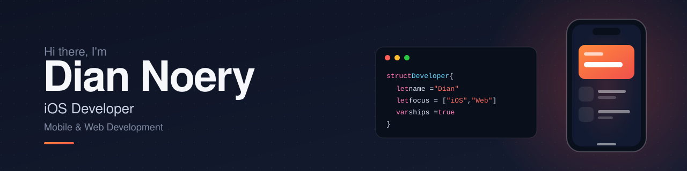

&#x20;\

&#x20; \
\

\<h2 align="center">Hi there, I'm Dian Noery 👋\</h2>

\

&#x20; \<strong>iOS Developer | Mobile & Web Development\</strong>
\

\

&#x20; Building elegant, scalable, and user-friendly applications.
\

\

&#x20; \<a href="[https://github.com/diannoery](https://github.com/diannoery)">
&#x20;   \
&#x20; \</a>
&#x20; \
&#x20; \
\

---

## 🛠 Tech Stack & Technologies

### 🍎 iOS Development

\

&#x20; \
&#x20; \
&#x20; \
&#x20; \
&#x20; \
&#x20; \
\

### 🤖 Android Development

\
   \   \   \ \

### 🌐 Web Development

\
   \   \   \   \ \

### 🏗 Architecture & Design Patterns

\
   \   \   \   \   \ \

### ⚙️ Tools & Technologies

\

&#x20; \
&#x20; \
&#x20; \
&#x20; \
&#x20; \
&#x20; \
&#x20; \
&#x20; \
\

---

## 💼 Professional Focus

- iOS Application Development
- UIKit & SwiftUI Development
- Android Application Development
- UI Implementation & API Integration
- Code Quality & Refactoring
- Application Performance Optimization
- Mobile Application Security

---

## 📖 Currently Learning

- Modern Swift & SwiftUI
- Advanced UIKit Development
- Kotlin & Jetpack Compose
- JavaScript & React.js
- Advanced Software Architecture
- Mobile Application Security
- CI/CD & Automated Testing

---

## 🤝 Open to Opportunities

- Remote iOS Development
- Freelance iOS Projects
- Mobile Application Development
- Contract-based Opportunities
- International Collaborations

---

## 📫 Connect With Me

\
   \<a href="[https://github.com/diannoery](https://github.com/diannoery)">     \   \</a>   \<a href="[https://www.linkedin.com/in/dian-afrilian-noery/](https://www.linkedin.com/in/dian-afrilian-noery/)">     \   \</a>   \<a href="mailto\:diannoery29\@gmail.com">     \   \</a> \

---

\
   \<i>Building better applications, one line of code at a time.\</i> \

